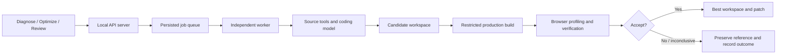

# Earl

### Better frames, with proof.

Earl is a local AI performance engineer for 3D web applications. Connect an
existing project, measure its rendering workload, let an agent investigate and
experiment with the code, and review a patch with evidence explaining what
improved and what was preserved.

The current implementation supports automatic integration with **Vite + Three.js
WebGL projects**. It combines project discovery, a source-inspecting coding agent,
a protected browser profiler, repeatable checks, and an independent job worker.


## Team handoff — start here

> **TEAMMATES 2 AND 3: DO NOT PUSH TO `main`. Work on your own branch, push that
> branch, and open a pull request targeting `main`. Do not merge your own PR.
> The project owner reviews and merges. This also applies to fixes and docs.**

### Shared context

Earl is a local performance engineer for existing interactive 3D web apps. A user
connects a project folder, describes what feels slow, and watches Earl measure,
inspect source, try an optimization, independently verify behavior and performance,
and offer a patch. The intended experience is: **open project → show the problem →
review a tested improvement**. The actual running app is the center of the product.

The current UI is too busy: stage tabs, perspective tools, metrics, controls and
side panels compete for attention. The goal is a simple professional tool, not a
metrics dashboard or a generic chat app. Preserve real execution while simplifying
its presentation. Our design reference is the owner's Morf project: generous scene
space, warm surfaces, restrained type, and contextual controls. Existing screenshots
in `verification/` show Earl's current state, not the final target design.

The AIE Code Summit problem statement we primarily target is **Trust but Verify**:
AI-generated improvements must survive independent, repeatable checks. The guide
weights the first round as technical demo 35%, implementation difficulty 30%,
impact 20%, and creativity 15%. A coherent working flow matters more than additional
panels. A dashboard cannot be the project's main feature. Existing project and
third-party code must be attributed; event-built work must be clearly identified.

**Current reality:** local Vite + Three.js WebGL is the supported automatic path.
Next.js and arbitrary engines are not established. We have measured a 400-object
fixture dropping from 400 to 2 draw calls with CPU submission p95 about 3.0 to 0.6 ms;
frame pacing stayed about 60 FPS. This is a fixture result, not a universal speedup.
See `VALIDATION-EARL.md`. Do not invent metrics or claim every interaction is proven.

**Owner / teammate 1 owns the core:** coding agent, Meta/Subquadratic integrations,
patch-specific risk review, independent verification, recorded interaction contract,
acceptance rules, protected profiler, patch promotion and final integration. These
are reserved for the owner. Sponsor award integrations are planned, not live-verified.

### Setup for both teammates

```sh
git clone https://github.com/odoisveryverygood/frameshift.git
cd frameshift
npm ci
npm run dev
```

Use Node 22+ and Google Chrome. Open `http://127.0.0.1:4310`. A local profile/example
build does not need a model key. Do not block your task on an AI optimization call;
the owner handles provider access. Never commit `.env.local`, API keys, `.frameshift`,
`node_modules`, private source or personal paths. Preserve licensed-code attribution.

Read your assignment and inspect its files before editing. Prefer the installed
React/Vite/Three.js/Express/Playwright stack. Propose dependency additions in your PR;
do not replace the framework or rewrite the backend. No fake success states or
silent mock fallbacks. If a check was not run, report it as not run.

### Teammate 2 — simple, excellent application UI

**Branch:** `teammate-2/earl-ui`

**Own:** `src/main.jsx`, `src/style.css`, `index.html`, and new frontend components
under `src/`. You own frontend presentation and accessibility. Do not edit backend,
SDK, examples, validation rules, credentials, or provider integrations. Coordinate
shared `package.json`/lockfile edits with the owner before making them.

**Deliverable:** a polished, responsive workspace where an unfamiliar user can
connect a project, enter a goal, understand progress, and review a real result
without learning the internals of our profiler.

Build this flow:

1. A slim header with Earl, the current project, and a small project/settings menu.
2. The user's running app occupies most of the workspace. Use its native controls;
   remove default Earl perspective buttons, axis decoration, and prominent scene
   editing tools. Keep useful inspection tools under Details when needed.
3. A narrow conversation/activity rail with one goal composer: “What feels slow?”
   and one primary action: “Improve performance.” This sends the existing mission
   to the real run endpoint. Render actual run events and findings as activity;
   do not fabricate a chat conversation or pretend unsupported chat endpoints exist.
4. Replace permanent Investigate/Experiment/Review navigation with automatic states:
   ready, building/measuring, trying a patch, checking, result. Keep advanced controls
   discoverable through a menu; do not remove capabilities merely to hide clutter.
5. While measuring, show an actual baseline image with a clear paused-for-measurement
   label. Do not keep a live WebGL preview running alongside performance benchmarks.
6. A result card shows the actual verdict and measurement with Compare, View code,
   and Apply. Code, evidence images, receipts and full logs expand on demand. A
   rejected/inconclusive result must be as clear as a successful one. No default wall
   of metric cards. All result elements must refer to the same run and experiment.
7. Keep working project connection, automatic first build, URL selection persistence,
   interaction recording, replay, comparison, export, apply confirmation/conflict
   errors, settings and cancellation. Simplify the controls; preserve their behavior.

**Visual direction:** warm ivory, charcoal, restrained rust accent, subtle borders,
clear hierarchy and generous spacing. Small intentional motion for state changes;
no decorative spinning 3D background, neon gradients, oversized cards, or extra
marketing page. Reference [Rive's contextual interface](https://rive.app/docs/editor/interface-overview)
and [Spline's scene-first editor](https://docs.spline.design/basics/understanding-splines-ui).

**Existing API contract — use it, do not redesign it:**

- `GET /api/state`: projects, runs, activeRun, worker and provider metadata.
- `POST /api/inspect` with `{path}`; `POST /api/projects` with `{path,trusted:true}`.
- `POST /api/projects/:id/runs` with `{kind:"profile"|"optimize",count,mission}`.
- `GET /api/events`: refresh notifications. `POST /api/stop` with `{runId}`.
- Existing source, scenario, preview, baseline, patch, apply, report, artifact and
  verifier-receipt endpoints remain authoritative; inspect current handlers and UI
  before wiring them. Preserve sandboxed iframe and internal `frameshift:*` messages.
- A connected project needs an initial profile to create its preview. Changing the
  project must update `?project=<id>` so refresh never returns to the wrong app.

**Done means:** `npm run build` and `npm test` pass; manually exercise connection,
first build, project switch+refresh, recording, stopping, and review; no browser
console errors; keyboard-accessible fields/buttons/dialogs; no horizontal overflow
at 390px; useful states for unsupported project, missing provider, build failure,
queued job, and no accepted changes. Save desktop/mobile screenshots and a short
walkthrough in your PR. Identify which end-to-end checks required the owner/model.
Do not label a browser fixture or screenshot as a live optimization run.

### Teammate 3 — project doctor, portable demo, reliable smoke checks

**Branch:** `teammate-3/project-readiness`

This is a complete developer-experience task, not placeholder documentation. Make
Earl easy to start and demonstrate on another laptop. You do not own the core AI,
sponsor integration, verifier, optimization algorithm, or UI redesign.

**Own:** `server/discovery.mjs`, `scripts/open.mjs`, a new `scripts/doctor.mjs`, related
readiness/CLI tests, a new standalone demo under `examples/orbit-lab/`, and your task
notes under `docs/team/`. Do not edit `src/`, `sdk/`, `server/agent.mjs`, `model.mjs`,
`runner.mjs`, `benchmark.mjs`, `verifier.mjs`, `core.mjs`, `worker.mjs`, or `jobs.mjs`.
Request owner integration for new API routes or runner hooks. Agree on package script
changes before touching `package.json` or the lockfile. Do not change existing demo
sources or recorded benchmark artifacts to make numbers look better.

Build these three pieces:

1. **Project doctor:** `node scripts/doctor.mjs /path/to/project`, plus `--json`.
   Read-only checks for folder/package validity, supported framework, Three.js version,
   identified entry, production build script, Node runtime, installed dependencies,
   and Chrome availability. Return structured findings with code, severity and
   actionable remediation. Use exit 0 when ready, exit 1 when blocked; warnings are
   distinct from blockers. Do not install packages, execute build scripts, invoke a
   model, open browsers, or mutate source during diagnosis. Do not print secrets.
   Preserve the `/api/inspect` response shape; additive findings are acceptable.
2. **Portable Orbit Lab demo:** a small real Vite + Three.js application with named
   animated objects, visible click-selection output, pause/resume and resize handling.
   Use authored simple geometry and no external asset URLs. Make ordinary inefficient
   mesh rendering a clearly documented optimization exercise, preserving all behavior.
   Include package/build files and straightforward standalone setup. No handwritten
   profiler adapter should be needed. The owner will run and evaluate AI optimization;
   your task is a dependable interactive input project, not a prewritten winning patch.
3. **Smoke verification:** reproducible commands that check doctor positive/negative
   cases, build the demo, connect it using the existing local CLI, wait for an actual
   profile to finish, and verify the preview loads. Assert behavior, not just HTTP 200:
   canvas renders, selection output changes after a real click, pause/resume works,
   resize produces a usable viewport. Use existing Playwright tooling. A failed step
   exits nonzero with a useful error. Keep model access optional and never mock a live
   result. Clean only resources the test created and preserve other users' jobs.

**Done means:** doctor checks cover missing folder, trailing spaces, invalid package,
unsupported framework and missing dependency/build prerequisites; unit tests use
portable temporary folders; demo builds from its own directory; a fresh checkout has
copy-paste setup; the smoke check captures actual results and reports failures.
Document requirements, expected outputs, teardown, and what is not verified in
`docs/team/teammate-3-readiness.md`. The owner's machine path must not be required.
If automatic scene instrumentation fails, report the boundary to the owner rather
than altering verification or hardcoding synthetic success.

### Branch, PR, and integration rules — both teammates

**NO DIRECT PUSH TO `main`. PUSH YOUR FEATURE BRANCH AND OPEN A PR ONLY.**

```sh
git fetch origin
git switch -c teammate-2/earl-ui origin/main
# Teammate 3 uses teammate-3/project-readiness instead.
# Implement only your owned scope, then run its checks.
git add <your-files>
git commit -m "Describe your completed change"
git push -u origin teammate-2/earl-ui
# Open a pull request targeting main. Do not merge it yourself.
```

Teammate 3 replaces the branch name in both commands. If your branch already exists,
switch to it rather than recreating it. Never force-push shared branches, reset
someone else's work, stage `.env*`, or commit generated/private workspaces. Keep PRs
focused; do not run formatters over files another teammate owns. Ask the owner to
resolve shared-file changes and integration conflicts. The owner retains final merge
control. This README policy does not itself configure GitHub branch protection.

PR description must include: user-visible result, changed files, exact checks and
observed outcomes, screenshots or terminal evidence, remaining issues, and reused
code/licenses. Separate live, local, fixture/mock, and not-run evidence. Record your
actual event contributions; do not present the pre-existing Earl engine as newly built.

## Quick start

Requirements: **Node.js 22 or newer, npm, and Google Chrome**. A model provider
with function/tool calling is required for AI optimization; profiling runs locally
without a model request.

```sh
git clone https://github.com/odoisveryverygood/frameshift.git
cd frameshift
npm ci
npm run build
npm start
```

Open **http://127.0.0.1:4310**. Configure your provider through **Model settings**.
The application stores its key in an ignored local `.env.local` file with mode
`0600`; the browser never receives that key. `.env.example` documents the available
environment variables. Credentials are not included in this repository.

On macOS, `Launch Earl.command` also performs setup and starts the app.
For development, use `npm run dev`.

The start command launches a separate worker and the web server. Restarting the
web server does not cancel an executing job. `npm run worker` can start the worker
separately; interrupted work can resume when that worker restarts.

## Give Earl a mission

From this repository, connect a trusted local project:

```sh
npm run open -- /absolute/path/to/your-project
```

Earl starts or reuses its local service and opens the selected project. Enter a
performance goal such as “Reduce draw calls while preserving animation and object
selection,” then choose **Run experiment**. Earl captures a baseline, inspects
source, proposes a patch, and verifies the candidate. A performance target is a
goal, not a promise or permission to weaken correctness checks.

`--no-browser` prints the workspace URL. `--port 4320` selects another web port.
Connections are source snapshots; use `--fresh` to reconnect after external edits
while retaining the previous snapshot and history. No project ZIP upload is needed.
Project source remains local except for relevant source/context sent to your
configured model provider during an optimization. Builds execute project code;
connect projects you trust. Dependencies should be installed in the original folder.

## Independent verification receipts

The optimizer proposes edits; a deterministic verifier decides whether to promote
them. The optimizer cannot edit the protected test, configuration, or SDK paths.
Verification policy and verifier/profiler implementation hashes are sealed before
an experiment. After a successful correctness check and paired benchmark, the
verifier re-reads persisted evidence and writes `verdict.json` with artifact hashes, source and patch fingerprints,
policy, verdict, and coverage limits. Review offers **Inspect verifier receipt**.
A changing policy, missing evidence, invalid measurements, or a non-explicit guard
success blocks acceptance. Receipts establish provenance; they are not a guarantee
against hostile application code or proof of all possible application behavior.

The startup process supervises workers it launches with bounded restart backoff.
A pre-existing detached worker remains independent of the web process. Interrupted
jobs retain their safe checkpoints and mission; recovery does not repeat accepted
workspace promotions blindly.

## Hackathon contribution boundary

Earl builds on the pre-existing FrameShift engine and UI work. The Earl mission
flow, local connection command, redesigned workbench, verification receipts,
acceptance hardening, and worker supervision are incremental contributions; they
must be dated and distinguished from prior work in any event submission. This
repository's history and third-party credits preserve that distinction.

The primary problem statement is **Trust but Verify**. Experiment history informs
subsequent optimization attempts. Earl does **not** yet implement held-out adoption
of versioned agent skills, so it should not claim the full **System That Gets Better**
problem statement on that basis.

## The original vision

Developers building browser-based games, robotics simulators, CAD tools, and
interactive visualizations can spend substantial time finding and fixing low
frame rates, excessive rendering submissions, and inefficient update code.

Earl's original plan was to automate that investigation:

1. Run the application and establish a performance baseline.
2. Identify likely bottlenecks from measurements and source code.
3. Implement one optimization hypothesis.
4. Build and check the candidate's appearance and behavior.
5. Benchmark it against a fresh reference.
6. Keep successful changes and discard failed or inconclusive candidates.
7. Repeat while remembering previous experiments and their outcomes.

Candidate techniques include GPU instancing, geometry and material reuse,
allocation reduction, improved rendering/update logic, and faster spatial queries.
The system does not guarantee that any particular technique will improve a project.

The long-term ambition covers a broad range of 3D applications. The first
supported execution path is deliberately narrower: local Vite + Three.js WebGL.
Arbitrary repositories and rendering engines are not automatically compatible.

## The workflow

The interface centers the actual project and a natural-language performance mission, with three focused stages:

- **Investigate:** inspect the detected project, rendering workload, source, and baseline.
- **Experiment:** follow the agent's source inspection, hypothesis, patch, and checks.
- **Review:** inspect code changes, visual evidence, decisions, and the accepted version.

Measurements, logs, history, source details, and verification images live in
contextual drawers. The warm ivory background, charcoal type, and restrained rust accent
keep attention on the running application and its current experiment. Morf, Foundry, and Simtra informed
the design direction, especially Morf's scene-centered workspace.

### Connect a project

1. Install the project's normal dependencies in its original folder.
2. Choose **Connect project** and enter its absolute path.
3. Review the detected framework, entry points, engine version, and setup issues.
4. Confirm that you trust the project and its build command, then connect.
5. Profile the application and optionally record interactions for replay.
6. Run an optimization and review its evidence before exporting or applying changes.

Earl copies the project into a working area. The original source remains
unchanged until you explicitly choose **Apply**. Apply checks for conflicting
original-file edits and saves a backup.

## Project discovery and automatic integration

Discovery reads package configuration, identifies Vite/Three.js/R3F dependencies,
finds entry modules, indexes application source, and resolves local imports into a
source graph. Compatibility and dependency/build issues are surfaced to the user.

For the automatic path, a protected Vite plugin attaches the observer to a
production build in the working copy. A supported project does **not** need a
handwritten benchmark adapter. The installable integration package is in [`sdk/`](sdk/).

The profiler observes the actual renderer, scene, camera, and animation callbacks.
It gathers:

- CPU callback and render-submission time.
- Draw calls, triangles, and renderer resource counters.
- Animation-frame intervals.
- GPU timer-query measurements where available.
- Semantic object transforms, raycasting results, and selected application UI state.

Controlled clocks and randomness activate in benchmark pages using
`?__frameshift=1`. Normal previews retain normal application behavior. Camera paths
use fixed initial bounds; candidate screenshots can replay the exact reference
camera state.

Existing manual adapters remain supported for legacy projects and the original
included workloads. Those legacy examples do not expose the new SDK's interaction
recording surface. See [ADAPTER.md](ADAPTER.md) and [sdk/README.md](sdk/README.md).

## The source-inspecting coding agent

The agent does not simply receive the whole repository and return replacement files.
It has bounded tools to:

- List discovered application modules.
- Inspect import information and follow relevant modules.
- Search source and read line ranges.
- Examine profiles, history, failed checks, and repair feedback.
- Submit exact search-and-replace edits across eligible files.

Every changed file must have been inspected. Before a candidate is written,
Earl validates inspected-file hashes and uniquely matched edit text.
Stale or ambiguous edits are rejected.

The model has **no shell-command tool**. Its source tools cannot edit the protected
SDK, benchmark rules, build configuration, tests, environment files, or dependencies.
Builds execute the configured project command separately from model tool access.

A build or correctness failure can trigger up to **two focused repairs**. Source
reads, tool calls, rounds, model output, job duration, experiment count, and
recovery attempts are bounded. Tool actions and usage metadata are retained for
inspection; private chain-of-thought is not requested or displayed.

### What “self-improving” means

Earl improves the project's code through experiments. It retains successful
changes, failed approaches, reasons, and strategy information between iterations.
New iterations use that recorded context. This is **not model-weight training**.

## Independent verification and acceptance

A candidate must build and survive checks before it can replace the best workspace.

The current default includes:

- Eight scene/time/camera checkpoints.
- World-matrix comparisons for discovered semantic objects and instances.
- Forty raycasting probes across those checkpoints.
- Screenshot comparisons and saved difference images.
- Runtime/build failure detection.
- Replay of saved interactions and comparison of resulting scene, selection,
  status, and application output state.

Action recording supports up to 80 events over 60 seconds. Replays use normalized
canvas coordinates and real browser pointer/keyboard input.

Performance comparisons alternate reference/candidate order: **A/B, then B/A**.
Raw samples and repeat-level variability are saved. Small or noisy changes can be
marked **inconclusive** rather than credited as improvements.

For a high draw-count reference, the optimizer targets fewer draw calls while
protecting CPU submission and frame pacing. Otherwise it targets CPU callback/
submission p95 with a noise-aware acceptance threshold. GPU queries are reported
separately and are informational in the current acceptance policy.

Rejected and inconclusive experiments leave the best accepted version unchanged.
Accepted changes are available as a patch; applying them to the original project
is an explicit action.

These guards cover configured samples and actions. They cannot establish every
possible behavior or future state of an arbitrary application.

## Durable execution and build isolation



Jobs are persisted before execution. The API queues and observes work; a separate
worker executes it. A web-server restart preserves the running job. On worker
restart, interrupted work can resume from a completed baseline checkpoint, with
its interrupted attempt preserved in history. Workspace promotion has a recovery
journal. Cancellation is a persisted request consumed by the worker.

On macOS, builds run through `sandbox-exec` with sanitized credentials, user-file
reads restricted to the workspace/dependencies, writes restricted to the workspace,
and network access denied. Tests used harmless sentinel files and a loopback server
to verify those restrictions; they did not read real private files.

Other platforms currently receive a sanitized child-process environment without
the same macOS filesystem/network enforcement. This is a **local single-user tool
for trusted projects**, not an audited hostile-code execution service. A hosted
multi-user version would need separate authentication, tenant boundaries, quotas,
and dedicated VM/container runners.

## API providers

Live optimization has been tested using OpenAI Responses. The provider layer also
supports compatible Chat Completions function calls, covered by local contract tests.

A Meta/Llama-hosted provider requires a compatible endpoint, model, protocol, and
tool-calling support. Replacing only the key does not establish compatibility.
A native provider-specific API would require its own transport adapter. No native
Meta endpoint has been live-validated in this implementation.

Editable source, profiles, and relevant experiment history are sent to the configured
model provider during optimization. Local profiling does not make a model request.

## Repository foundations and acknowledgments

The two starting repositories supplied complementary foundations:

| Repository | Contribution to Earl |
|---|---|
| [hiddentao/3d-web-scene-performance-skill](https://github.com/hiddentao/3d-web-scene-performance-skill) | Performance guidance, verification principles, and the included engine compatibility probe. Guidance and probe are retained with attribution. |
| [JoaquinMulet/Artificial-General-Research](https://github.com/JoaquinMulet/Artificial-General-Research) | Experiment-loop ideas: fresh context, persistent history, metric/guard separation, reference remeasurement, and keep/discard decisions. |

Earl does **not** embed AGR's complete CLI or Docker stack. Its runner,
worker, browser harness, verification system, and interface are its own integration.
The upstream repositories' published speedups are not Earl results.

Other runtime building blocks include:

| Library | Role |
|---|---|
| Three.js | Included scenes and renderer integration |
| React, Vite, Express | Interface, builds, and local API |
| Playwright Core | Browser execution, inputs, and screenshots |
| Pixelmatch and PNGJS | Screenshot comparisons and difference images |
| Spector.js | Separate instrumented WebGL diagnostic captures |
| jsdiff | Reviewable and exportable source patches |
| Lucide | Interface icons |

Spector captures are separate from timing benchmarks because instrumentation can
affect performance. See [THIRD_PARTY.md](THIRD_PARTY.md) for source snapshots,
license notices, and attribution. Upstream license files are included in `vendor/`.

## What has actually been demonstrated

Measurements below are from **authored local test projects on one Apple M4
machine**, not customer deployments or evidence of broad generalization.

| Workload | Observed result |
|---|---|
| Historical 1,600-object warehouse workload | Draw calls **1,611 → 13**; paired CPU submission p95 **3.2 → 0.8 ms**. The rAF-derived rate stayed near 60 Hz and the GPU query reading increased. |
| Automatically imported plain Three.js fixture | Draw calls **25 → 2**; paired CPU p95 **1.1 → 0.6 ms**. Eight checkpoints, 40 picking probes, and a recorded click replay passed. |

**Twenty unit/contract tests passed.** A live job continued through a web-server
restart. A deliberately interrupted worker was replaced and the job resumed its
baseline checkpoint while preserving the interrupted attempt. Other experiments
were rejected or left inconclusive; those outcomes are retained.

CPU submission time is not GPU execution time or energy use. Controlled-harness
rAF intervals do not prove completed GPU frames or higher displayed FPS. The earlier
warehouse result must not be described as a 4× FPS increase or lower GPU time.

Evidence and detailed limits:

- [Current verification record](VALIDATION-v0.2.md)
- [Historical verification record](VALIDATION.md)
- [Live automatic-import run and source-tool trace](verification/v0.2-live-run.json)
- [Automatic SDK verification](verification/automatic-sdk.json)
- [Worker interruption and recovery](verification/worker-recovery.json)
- [Engine compatibility probe output](verification/engine-probe.json)

## Supported scope and remaining work

- Automatic execution: **Vite + Three.js WebGL**.
- R3F: detected through its Three renderer; a separate full R3F application has
  not been live-tested here.
- Next.js and WebGPU: identified, but automatic execution is not supported.
- GitHub OAuth/project connection and automatic PR creation: not implemented;
  project input is local and delivery is patch export or explicit local Apply.
- Hosted multi-user service, physical-phone testing, and broad hardware validation:
  not implemented or established by these local checks.

A substantial independently built project, with meaningful recorded interactions,
is the next important generalization test. Additional API keys alone do not remove
these compatibility and verification requirements.

## Development and checks

```sh
npm test
npm run build
npm run sdk:verify
npm run verify
```

`npm run verify` needs the local API and an idle worker. It tests import, build/profile,
patch export, Apply/backups, conflicts, cancellation, route restrictions, and history
retention using its own fixture. It does not spend model tokens.

`scripts/recovery-check.mjs` deliberately interrupts the local worker during an
optimization and spends model tokens. Run it deliberately, not in normal CI.
The included GitHub Actions workflow runs unit/contract checks and the UI build.

| Directory | Contents |
|---|---|
| `src/` | Three-stage React interface and contextual drawers |
| `server/discovery.mjs`, `server/integration.mjs` | Project indexing and instrumented builds |
| `server/agent.mjs` | Source tools, targeted edits, and model tool loop |
| `server/runner.mjs`, `server/worker.mjs`, `server/jobs.mjs` | Experiments, queue, checkpoints, and recovery |
| `server/benchmark.mjs` | Browser measurements, captures, replay, and guards |
| `server/isolation.mjs` | Build environment and macOS restrictions |
| `sdk/` | Protected renderer observer and Vite plugin |
| `examples/`, `tests/fixtures/` | Authored workloads and test projects |
| `tests/`, `verification/` | Automated checks and saved local evidence |
| `vendor/` | Attributed guidance, engine probe, and upstream license notices |

Local credentials, `node_modules/`, generated `dist/`, logs, and private `.frameshift/`
workspaces/job state are excluded from Git. The source, SDK, examples, tests,
documentation, and selected authored verification artifacts are included.
