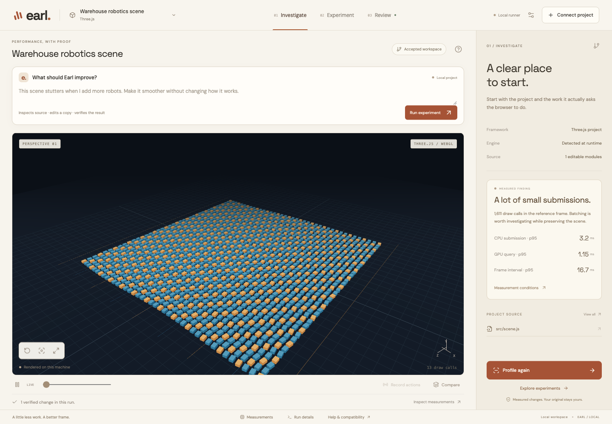
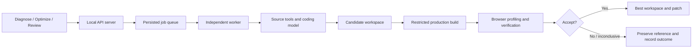

# Earl

### Better frames, with proof.

**Teammates: [read the updated product, agent and sponsor plan](docs/TEAM-PRODUCT-PLAN.md).**
It includes ownership, build order, verified setup status, and how to explain each
sponsor honestly. **Feature branches and PRs only; no direct pushes to `main`.**

The next product flow is: open your 3D app → describe the slowdown → three agents
investigate, patch and verify → compare and apply. Meta and Subquadratic wiring
are planned; Fetch local handoff and ASI API connectivity have been verified.
See [the exact setup status](integrations/SETUP-STATUS.md).

Earl is a local AI performance engineer for 3D web applications. Connect an
existing project, measure its rendering workload, let an agent investigate and
experiment with the code, and review a patch with evidence explaining what
improved and what was preserved.

The current implementation supports automatic integration with **Vite + Three.js
WebGL projects**. It combines project discovery, a source-inspecting coding agent,
a protected browser profiler, repeatable checks, and an independent job worker.



## Quick start

Requirements: **Node.js 22 or newer, npm, and Google Chrome**. A model provider
with function/tool calling is required for AI optimization; profiling runs locally
without a model request.

```sh
git clone https://github.com/odoisveryverygood/frameshift.git
cd frameshift
npm ci
npm run build
npm start
```

Open **http://127.0.0.1:4310**. Configure your provider through **Model settings**.
The application stores its key in an ignored local `.env.local` file with mode
`0600`; the browser never receives that key. `.env.example` documents the available
environment variables. Credentials are not included in this repository.

On macOS, `Launch Earl.command` also performs setup and starts the app.
For development, use `npm run dev`.

The start command launches a separate worker and the web server. Restarting the
web server does not cancel an executing job. `npm run worker` can start the worker
separately; interrupted work can resume when that worker restarts.

## Executable Skill Lab

Open **http://127.0.0.1:4310/lab/** with Earl running. The configured model learns a
reusable JavaScript source transformer from an authored training application and
training-only failures. Earl runs it in a separate restricted process, checks the
base app plus geometry/hierarchy stress cases, then freezes the code and evaluates
it on two other applications without another model call. Both must pass independent
behavior/performance gates before the active skill version changes.

This is a bounded `createWorld(THREE, scene)` instancing family, not universal
Three.js optimization. The authored evaluation suite is withheld from the generator
and reused across runs. Local records retain generated code, parent versions,
training contexts, failures, screenshots, measurements and adoption decisions.
See [the implementation and evidence boundaries](docs/SKILL-LAB.md).

```sh
# Verify a real completed adopted run without starting another model request:
node scripts/verify-skill-lab.mjs --run YOUR_RUN_ID
```

## Give Earl a mission

From this repository, connect a trusted local project:

```sh
npm run open -- /absolute/path/to/your-project
```

Earl starts or reuses its local service and opens the selected project. Enter a
performance goal such as “Reduce draw calls while preserving animation and object
selection,” then choose **Run experiment**. Earl captures a baseline, inspects
source, proposes a patch, and verifies the candidate. A performance target is a
goal, not a promise or permission to weaken correctness checks.

`--no-browser` prints the workspace URL. `--port 4320` selects another web port.
Connections are source snapshots; use `--fresh` to reconnect after external edits
while retaining the previous snapshot and history. No project ZIP upload is needed.
Project source remains local except for relevant source/context sent to your
configured model provider during an optimization. Builds execute project code;
connect projects you trust. Dependencies should be installed in the original folder.

## Independent verification receipts

The optimizer proposes edits; a deterministic verifier decides whether to promote
them. The optimizer cannot edit the protected test, configuration, or SDK paths.
Verification policy and verifier/profiler implementation hashes are sealed before
an experiment. After a successful correctness check and paired benchmark, the
verifier re-reads persisted evidence and writes `verdict.json` with artifact hashes, source and patch fingerprints,
policy, verdict, and coverage limits. Review offers **Inspect verifier receipt**.
A changing policy, missing evidence, invalid measurements, or a non-explicit guard
success blocks acceptance. Receipts establish provenance; they are not a guarantee
against hostile application code or proof of all possible application behavior.

The startup process supervises workers it launches with bounded restart backoff.
A pre-existing detached worker remains independent of the web process. Interrupted
jobs retain their safe checkpoints and mission; recovery does not repeat accepted
workspace promotions blindly.

## Hackathon contribution boundary

Earl builds on the pre-existing FrameShift engine and UI work. The Earl mission
flow, local connection command, redesigned workbench, verification receipts,
acceptance hardening, and worker supervision are incremental contributions; they
must be dated and distinguished from prior work in any event submission. This
repository's history and third-party credits preserve that distinction.

The primary problem statement is **Trust but Verify**. Experiment history informs
subsequent optimization attempts. The executable Skill Lab adds versioned skill generation and held-out adoption
for a bounded rendering family. Its **System That Gets Better** claim is limited
to the measured authored cohort and training-only refinement, not model retraining
or general-purpose self-improvement.

## The original vision

Developers building browser-based games, robotics simulators, CAD tools, and
interactive visualizations can spend substantial time finding and fixing low
frame rates, excessive rendering submissions, and inefficient update code.

Earl's original plan was to automate that investigation:

1. Run the application and establish a performance baseline.
2. Identify likely bottlenecks from measurements and source code.
3. Implement one optimization hypothesis.
4. Build and check the candidate's appearance and behavior.
5. Benchmark it against a fresh reference.
6. Keep successful changes and discard failed or inconclusive candidates.
7. Repeat while remembering previous experiments and their outcomes.

Candidate techniques include GPU instancing, geometry and material reuse,
allocation reduction, improved rendering/update logic, and faster spatial queries.
The system does not guarantee that any particular technique will improve a project.

The long-term ambition covers a broad range of 3D applications. The first
supported execution path is deliberately narrower: local Vite + Three.js WebGL.
Arbitrary repositories and rendering engines are not automatically compatible.

## The workflow

The interface centers the actual project and a natural-language performance mission, with three focused stages:

- **Investigate:** inspect the detected project, rendering workload, source, and baseline.
- **Experiment:** follow the agent's source inspection, hypothesis, patch, and checks.
- **Review:** inspect code changes, visual evidence, decisions, and the accepted version.

Measurements, logs, history, source details, and verification images live in
contextual drawers. The warm ivory background, charcoal type, and restrained rust accent
keep attention on the running application and its current experiment. Morf, Foundry, and Simtra informed
the design direction, especially Morf's scene-centered workspace.

### Connect a project

1. Install the project's normal dependencies in its original folder.
2. Choose **Connect project** and enter its absolute path.
3. Review the detected framework, entry points, engine version, and setup issues.
4. Confirm that you trust the project and its build command, then connect.
5. Profile the application and optionally record interactions for replay.
6. Run an optimization and review its evidence before exporting or applying changes.

Earl copies the project into a working area. The original source remains
unchanged until you explicitly choose **Apply**. Apply checks for conflicting
original-file edits and saves a backup.

## Project discovery and automatic integration

Discovery reads package configuration, identifies Vite/Three.js/R3F dependencies,
finds entry modules, indexes application source, and resolves local imports into a
source graph. Compatibility and dependency/build issues are surfaced to the user.

For the automatic path, a protected Vite plugin attaches the observer to a
production build in the working copy. A supported project does **not** need a
handwritten benchmark adapter. The installable integration package is in [`sdk/`](sdk/).

The profiler observes the actual renderer, scene, camera, and animation callbacks.
It gathers:

- CPU callback and render-submission time.
- Draw calls, triangles, and renderer resource counters.
- Animation-frame intervals.
- GPU timer-query measurements where available.
- Semantic object transforms, raycasting results, and selected application UI state.

Controlled clocks and randomness activate in benchmark pages using
`?__frameshift=1`. Normal previews retain normal application behavior. Camera paths
use fixed initial bounds; candidate screenshots can replay the exact reference
camera state.

Existing manual adapters remain supported for legacy projects and the original
included workloads. Those legacy examples do not expose the new SDK's interaction
recording surface. See [ADAPTER.md](ADAPTER.md) and [sdk/README.md](sdk/README.md).

## The source-inspecting coding agent

The agent does not simply receive the whole repository and return replacement files.
It has bounded tools to:

- List discovered application modules.
- Inspect import information and follow relevant modules.
- Search source and read line ranges.
- Examine profiles, history, failed checks, and repair feedback.
- Submit exact search-and-replace edits across eligible files.

Every changed file must have been inspected. Before a candidate is written,
Earl validates inspected-file hashes and uniquely matched edit text.
Stale or ambiguous edits are rejected.

The model has **no shell-command tool**. Its source tools cannot edit the protected
SDK, benchmark rules, build configuration, tests, environment files, or dependencies.
Builds execute the configured project command separately from model tool access.

A build or correctness failure can trigger up to **two focused repairs**. Source
reads, tool calls, rounds, model output, job duration, experiment count, and
recovery attempts are bounded. Tool actions and usage metadata are retained for
inspection; private chain-of-thought is not requested or displayed.

### What “self-improving” means

Earl improves the project's code through experiments. It retains successful
changes, failed approaches, reasons, and strategy information between iterations.
New iterations use that recorded context. This is **not model-weight training**.

## Independent verification and acceptance

A candidate must build and survive checks before it can replace the best workspace.

The current default includes:

- Eight scene/time/camera checkpoints.
- World-matrix comparisons for discovered semantic objects and instances.
- Forty raycasting probes across those checkpoints.
- Screenshot comparisons and saved difference images.
- Runtime/build failure detection.
- Replay of saved interactions and comparison of resulting scene, selection,
  status, and application output state.

Action recording supports up to 80 events over 60 seconds. Replays use normalized
canvas coordinates and real browser pointer/keyboard input.

Performance comparisons alternate reference/candidate order: **A/B, then B/A**.
Raw samples and repeat-level variability are saved. Small or noisy changes can be
marked **inconclusive** rather than credited as improvements.

For a high draw-count reference, the optimizer targets fewer draw calls while
protecting CPU submission and frame pacing. Otherwise it targets CPU callback/
submission p95 with a noise-aware acceptance threshold. GPU queries are reported
separately and are informational in the current acceptance policy.

Rejected and inconclusive experiments leave the best accepted version unchanged.
Accepted changes are available as a patch; applying them to the original project
is an explicit action.

These guards cover configured samples and actions. They cannot establish every
possible behavior or future state of an arbitrary application.

## Durable execution and build isolation



Jobs are persisted before execution. The API queues and observes work; a separate
worker executes it. A web-server restart preserves the running job. On worker
restart, interrupted work can resume from a completed baseline checkpoint, with
its interrupted attempt preserved in history. Workspace promotion has a recovery
journal. Cancellation is a persisted request consumed by the worker.

On macOS, builds run through `sandbox-exec` with sanitized credentials, user-file
reads restricted to the workspace/dependencies, writes restricted to the workspace,
and network access denied. Tests used harmless sentinel files and a loopback server
to verify those restrictions; they did not read real private files.

Other platforms currently receive a sanitized child-process environment without
the same macOS filesystem/network enforcement. This is a **local single-user tool
for trusted projects**, not an audited hostile-code execution service. A hosted
multi-user version would need separate authentication, tenant boundaries, quotas,
and dedicated VM/container runners.

## API providers

Live optimization has been tested using OpenAI Responses. The provider layer also
supports compatible Chat Completions function calls, covered by local contract tests.

A Meta/Llama-hosted provider requires a compatible endpoint, model, protocol, and
tool-calling support. Replacing only the key does not establish compatibility.
A native provider-specific API would require its own transport adapter. No native
Meta endpoint has been live-validated in this implementation.

Editable source, profiles, and relevant experiment history are sent to the configured
model provider during optimization. Local profiling does not make a model request.

## Repository foundations and acknowledgments

The two starting repositories supplied complementary foundations:

| Repository | Contribution to Earl |
|---|---|
| [hiddentao/3d-web-scene-performance-skill](https://github.com/hiddentao/3d-web-scene-performance-skill) | Performance guidance, verification principles, and the included engine compatibility probe. Guidance and probe are retained with attribution. |
| [JoaquinMulet/Artificial-General-Research](https://github.com/JoaquinMulet/Artificial-General-Research) | Experiment-loop ideas: fresh context, persistent history, metric/guard separation, reference remeasurement, and keep/discard decisions. |

Earl does **not** embed AGR's complete CLI or Docker stack. Its runner,
worker, browser harness, verification system, and interface are its own integration.
The upstream repositories' published speedups are not Earl results.

Other runtime building blocks include:

| Library | Role |
|---|---|
| Three.js | Included scenes and renderer integration |
| React, Vite, Express | Interface, builds, and local API |
| Playwright Core | Browser execution, inputs, and screenshots |
| Pixelmatch and PNGJS | Screenshot comparisons and difference images |
| Spector.js | Separate instrumented WebGL diagnostic captures |
| jsdiff | Reviewable and exportable source patches |
| Lucide | Interface icons |

Spector captures are separate from timing benchmarks because instrumentation can
affect performance. See [THIRD_PARTY.md](THIRD_PARTY.md) for source snapshots,
license notices, and attribution. Upstream license files are included in `vendor/`.

## What has actually been demonstrated

Measurements below are from **authored local test projects on one Apple M4
machine**, not customer deployments or evidence of broad generalization.

| Workload | Observed result |
|---|---|
| Historical 1,600-object warehouse workload | Draw calls **1,611 → 13**; paired CPU submission p95 **3.2 → 0.8 ms**. The rAF-derived rate stayed near 60 Hz and the GPU query reading increased. |
| Automatically imported plain Three.js fixture | Draw calls **25 → 2**; paired CPU p95 **1.1 → 0.6 ms**. Eight checkpoints, 40 picking probes, and a recorded click replay passed. |

**Twenty unit/contract tests passed.** A live job continued through a web-server
restart. A deliberately interrupted worker was replaced and the job resumed its
baseline checkpoint while preserving the interrupted attempt. Other experiments
were rejected or left inconclusive; those outcomes are retained.

CPU submission time is not GPU execution time or energy use. Controlled-harness
rAF intervals do not prove completed GPU frames or higher displayed FPS. The earlier
warehouse result must not be described as a 4× FPS increase or lower GPU time.

Evidence and detailed limits:

- [Current verification record](VALIDATION-v0.2.md)
- [Historical verification record](VALIDATION.md)
- [Live automatic-import run and source-tool trace](verification/v0.2-live-run.json)
- [Automatic SDK verification](verification/automatic-sdk.json)
- [Worker interruption and recovery](verification/worker-recovery.json)
- [Engine compatibility probe output](verification/engine-probe.json)

## Supported scope and remaining work

- Automatic execution: **Vite + Three.js WebGL**.
- R3F: detected through its Three renderer; a separate full R3F application has
  not been live-tested here.
- Next.js and WebGPU: identified, but automatic execution is not supported.
- GitHub OAuth/project connection and automatic PR creation: not implemented;
  project input is local and delivery is patch export or explicit local Apply.
- Hosted multi-user service, physical-phone testing, and broad hardware validation:
  not implemented or established by these local checks.

A substantial independently built project, with meaningful recorded interactions,
is the next important generalization test. Additional API keys alone do not remove
these compatibility and verification requirements.

## Development and checks

```sh
npm test
npm run build
npm run sdk:verify
npm run verify
```

`npm run verify` needs the local API and an idle worker. It tests import, build/profile,
patch export, Apply/backups, conflicts, cancellation, route restrictions, and history
retention using its own fixture. It does not spend model tokens.

`scripts/recovery-check.mjs` deliberately interrupts the local worker during an
optimization and spends model tokens. Run it deliberately, not in normal CI.
The included GitHub Actions workflow runs unit/contract checks and the UI build.

| Directory | Contents |
|---|---|
| `src/` | Three-stage React interface and contextual drawers |
| `server/discovery.mjs`, `server/integration.mjs` | Project indexing and instrumented builds |
| `server/agent.mjs` | Source tools, targeted edits, and model tool loop |
| `server/runner.mjs`, `server/worker.mjs`, `server/jobs.mjs` | Experiments, queue, checkpoints, and recovery |
| `server/benchmark.mjs` | Browser measurements, captures, replay, and guards |
| `server/isolation.mjs` | Build environment and macOS restrictions |
| `sdk/` | Protected renderer observer and Vite plugin |
| `examples/`, `tests/fixtures/` | Authored workloads and test projects |
| `tests/`, `verification/` | Automated checks and saved local evidence |
| `vendor/` | Attributed guidance, engine probe, and upstream license notices |

Local credentials, `node_modules/`, generated `dist/`, logs, and private `.frameshift/`
workspaces/job state are excluded from Git. The source, SDK, examples, tests,
documentation, and selected authored verification artifacts are included.
