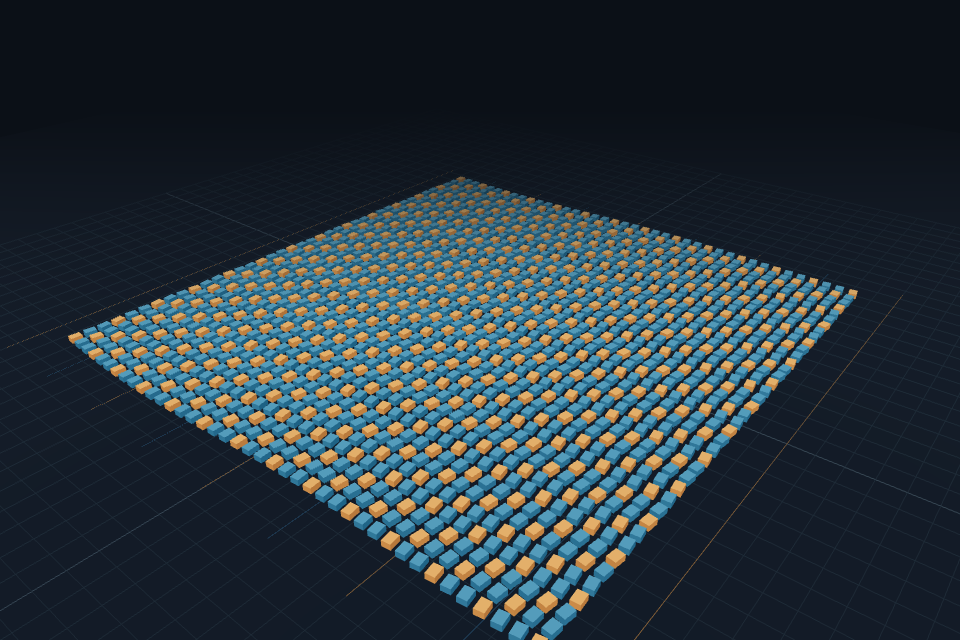

# Earl's specialist pipeline

Earl is a local performance engineering tool for Vite + Three.js WebGL projects. Open a trusted project, describe the slowdown, run one experiment, and review a patch with measured evidence. The original project changes only after Apply.

## What makes this agentic

The Investigator has a separate Meta conversation and a read-only tool allowlist. It lists source, follows the discovered import graph, reads relevant modules and profiles, and submits a hypothesis with source-hashed citations and a measurable objective. Unread or stale citations cannot finish the investigation.

The Optimizer receives that brief in a new Meta context. It chooses source tools and submits exact, uniquely matched edits to inspected files. Those edits are written into an isolated candidate. It cannot edit the harness, tests, environment or build configuration, and has no shell or network tool. A failed candidate can trigger at most two targeted repair attempts with actual failure feedback.

The Verifier uses Subquadratic's structured decisions to assess identity, animation, geometry and timing risks. Scores at or above 0.35 add protected time/camera checkpoints, at most eight. The baseline checkpoints, interaction scenario and tolerances remain. Both the original-behavior capture and the candidate execute the expanded plan. Screenshot, transform and picking checks must pass before fresh alternating A/B and B/A measurements can produce an acceptance decision. Model confidence cannot approve a patch.

Three stable Fetch uAgents identities carry typed handoffs:

```text
Investigator --InvestigationReady--> Optimizer
Optimizer   --PatchReady-----------> Verifier
Verifier    --VerificationResult---> Investigator
```

The worker awaits real local SDK dispatch receipts before moving on. Job/attempt IDs, source hashes and candidate hashes must match. Duplicates, stale revisions and out-of-order requests fail. The Node worker owns durable jobs, cancellation and promotion; the Python process owns local uAgents dispatch. Separate identities and contexts do not imply three different model families.

## Configuration

Set these only in ignored backend `.env.local`:

```dotenv
EARL_SPONSOR_MODE=1
MODEL_API_KEY=<your Meta key>
META_MODEL=muse-spark-1.3
SUBQ_API_KEY=<your Subquadratic key>
```

Use Node 22+ and install the pinned Python runtime using [Fetch setup](../integrations/fetch/README.md). Run `npm ci`, `npm run dev`, and open http://127.0.0.1:4310. Select Warehouse robotics for an authored repeatable workload, or connect a supported project. Choose **Improve performance**. Sponsor mode defaults to one candidate and allows two repairs. Missing sponsor access fails explicitly; it never silently substitutes OpenAI. Disable sponsor mode to use the previous configured-provider flow.

Meta's Responses adapter uses `tool_choice: auto`, low reasoning effort and encrypted-state replay. At most two no-tool continuations are permitted inside the existing tool, round and timeout limits. Prose is never accepted as a patch. ASI is optional inference access, independently connectivity-tested; it does not power this main pipeline.

## Evidence and review

The live activity rail shows actual source tools. Run report JSON includes the investigation, source observations, patch, selected risks and handoff receipts. Local experiment artifacts include:

- `investigation.json`: source-backed brief and safe tool trace.
- `risk-assessment.json`: live SubQ probabilities and input hash.
- `verification-plan.json`: expanded configuration and sealed policy.
- `verification-request.json`: revision-bound PatchReady receipt.
- `agent-handoffs.json`: complete local transport transcript.
- `reference-states.json`, `candidate-states.json`, screenshots and `guards.json`.
- Paired raw measurement files, patch and `verdict.json`.

Receipts bind the patch, request, source/candidate hashes, risk plan and executed checkpoint coverage. Failed repair attempts retain artifact snapshots. Correctness uses the protected original build; performance compares against the current best build. A policy/implementation change during an experiment blocks promotion.

Verify a completed run's recorded evidence without new model calls:

```sh
node scripts/verify-specialist-run.mjs RUN_ID
```

## Honest limits

Fetch transport is local in-process SDK dispatch, with outbound networking disabled. Agentverse account sign-in is complete, but public endpoints, mailboxes, remote delivery and ASI discovery are not registered or verified. The Verifier is not yet exposed as a public agent others can call. Local handoffs do not establish public discovery.

The default workload is authored, not customer evidence. Tests cover sampled times/views and recorded interactions, not every possible behavior. CPU submission time is not GPU utilization, and reduced draw calls need not increase FPS on a display-limited scene. Skill Lab remains separate advanced learning with its existing bounded cohort. ts-morph and fast-check remain proposed additions; this implementation uses the existing source graph and deterministic scenario machinery.

The interface has focused sponsor-aware labels and real tool activity; a comprehensive visual redesign remains the UI teammate's lane. These integrations do not establish hackathon eligibility or guarantee an award.

## Verified local result — November 7, 2026

Run `ca98df11-ab6`, experiment `2159ea46-5e3`, completed and was accepted. On the authored 1,600-robot warehouse: draw calls **1,611 → 13**, CPU submission p95 **8.7 → 1.2 ms**, and frame p95 **16.8 → 16.7 ms**. All 16 checkpoints passed, including eight added after live SubQ decisions. All three Fetch handoffs and every receipt artifact hash passed verification. This is not evidence of an FPS increase or independent customer performance.

The full Node test suite passed **59 tests**, and the production build passed. Earlier real development runs stopped on a missing model tool call and on a verifier implementation change; neither was promoted. See [sanitized live evidence](../verification/specialist-live-summary.json).



