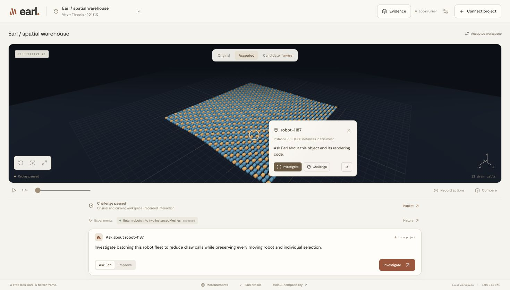

# Earl: work inside the scene

The spatial workspace connects real selections to source-backed investigation, runnable experiments and replayable challenges. The supported starting point remains a trusted local Vite + Three.js WebGL project.

## Use it

1. Connect a supported project or choose a bundled workload. The first profile builds a copy and establishes the reference.
2. Click a visible object. The pin shows the actual semantic ID or instance index and rendering-group size. Enter a goal and use **Ask Earl**.
3. Argon receives a backend-captured screenshot, a validated selected ID, camera/time, whole-frame counters and read-only source tools. Open Evidence for the capture, inspected citations, proposed check and uncertainty. Source associations currently remain **inferred**, not creation-site instrumentation.
4. Choose **Improve**. The saved finding passes to Meta's separate patch context through the local Fetch handoff. A successfully built candidate becomes available with **Testing** status. Timed benchmarks suspend competing previews. A passing verdict makes the patch available for review and Apply; source stays unchanged until Apply.
5. Select an object and choose **Challenge**. The scene freezes at that captured moment. Click the same object, then **Save & test**. The independent worker replays the actual recorded events on original and current builds, checking selection, transforms, picking and observable app state. Results are passed, rejected, or inconclusive. This challenge checks selection at a captured moment; it does not infer arbitrary natural-language correctness.
6. Use Original / Current / Candidate to reuse camera and simulation state where supported. The timeline retains real experiment status. Source changes mark old findings stale; accepted/rejected outcomes feed the next investigation as historical evidence.

## Provider setup

Keep `GEMINI_API_KEY`, `MODEL_API_KEY` and `SUBQ_API_KEY` only in ignored backend `.env.local`. Set `EARL_INVESTIGATOR_PROVIDER=gemini` and `EARL_SPONSOR_MODE=1` for Argon -> Meta -> SubQ + deterministic checks. The Argon adapter uses `gemini-4-argon` and native multimodal function calls. Provider denial fails explicitly; Meta can be selected explicitly, with no silent fallback.

Argon has a durable **estimated $5 application budget**, with conservative token-cost estimates, bounded source reads, 18 tools, seven rounds and a 150-second request-loop deadline. This is not a Google billing cap. It does not call the model on every rendered frame. API keys are never included in frontend state.

## Backend contracts for teammates

| Operation | Endpoint / message | Real result |
|---|---|---|
| Scene selection/context | `frameshift:context`, `frameshift:selection` | IDs, mesh/instance metadata, projected anchor, camera/time, whole-frame counters and capabilities |
| Restore view | `frameshift:sync` | Validated camera and time; selected markers never add WebGL draw calls |
| Investigate selection | `POST /api/projects/:id/findings` with `{goal,context}` | Persisted finding with actual provider/model, inspected citation hashes, revision and capture |
| Read findings | `GET /api/projects/:id/findings` | `{revision,findings}` with stale flags |
| Start experiment | `POST /api/projects/:id/runs` with `{kind:"optimize",mission,findingId,sceneContext}` | Durable worker run; stale findings rejected |
| Preview candidate | `/candidate/:run/:experiment/index.html` | Actual built candidate, available only after build; known local IDs only |
| Challenge selection | `POST /api/projects/:id/challenges` with `{context,scenario:{events},expectedSelection}` | Queued worker job, no client-supplied filesystem path |
| Read challenges | `GET /api/projects/:id/challenges` | Status, actual expected/observed IDs, tested points, screenshots and source revision |

The worker owns durable execution, cancellation, outcome history and promotion. The runtime's parent-message boundary checks source/origin; the outer UI accepts only its own frame messages. Source references, screenshot contents and model instructions remain untrusted data. Builds and browser checks retain their existing isolation limits.

## Checks

```sh
npm test
npm run build
node tests/spatial-runtime-live.mjs
node scripts/verify-specialist-run.mjs RUN_ID
```

The explicit browser smoke uses fresh authored automatic and manual fixtures. It checks real clicks, semantic IDs, camera synchronization, unchanged WebGL submission counts and disabled benchmark overlays. Findings tests exercise source revisions, inferred associations, multimodal function transport, unread citations and provider failures. Challenge tests require an observed reference target and reject lost selection or changed application state.

## Design references and limits

[Anatomy](https://github.com/wheresryan22/anatomy) inspired precise, contextual annotations. [Etch](https://github.com/PranavAchar01/etch) inspired selecting a real part, asking about it in place and inspecting runnable results. This layer does not vendor code from either repository; Earl retains its Three.js observer and verifier.

Public Agentverse discovery and remote delivery remain unverified. The spatial runtime supports observed WebGL scenes, not arbitrary engines or timer/network-driven simulations. Existing manual snapshots need a fresh connection to receive the new helper. Source creation-site mapping, object-specific GPU timing, arbitrary generated test code and animated exploded rendering graphs are not implemented. Whole-frame counters are labeled as such.

## Verified local handoff — November 7, 2026

The final authored warehouse run `044ebef8-989` used live `gemini-4-argon` to investigate a real selected robot and backend screenshot. Its source-backed finding was handed to Meta. Meta's initial candidate had a runtime error, received actual failure feedback, and repaired it. SubQ selected eight additional checkpoints; all 16 passed. The accepted candidate reduced draw calls **1,611 → 13** and CPU submission p95 **8.0 → 1.7 ms** in this local paired run.

The browser-recorded challenge selected `robot-1187` in both original and optimized scenes. The final receipt-bearing replay is `fec70c01-ccd`; its screenshots, implementation hashes and actual observed IDs passed verification. A mismatched earlier replay was inconclusive. Original/Candidate/Accepted switches were checked in the production UI; the same ID changed from an ordinary mesh to instance 791 in a 1,066-instance group. Candidate HTML and modules load inside the sandbox while opaque-origin API requests remain denied.

All **68 Node tests**, the production build, live automatic/manual runtime checks, recorded evidence checks, and a credential scan passed. An inherited idle worker was terminated and the starter's health monitor successfully replaced it. This is local evidence on an authored workload, not a universal performance or public Agentverse claim.

```sh
node scripts/verify-specialist-run.mjs 044ebef8-989
node scripts/verify-spatial-run.mjs 044ebef8-989 fec70c01-ccd
```

These commands read local retained run records; fresh checkouts must run their own experiments. Sanitized example evidence is in [spatial-live-summary.json](../verification/spatial-live-summary.json).


